`# LinkshellManager — In-Game Addon Guide (`lsm`)

> A Lua addon for **Ashita v3**. It runs your linkshell's **HNM camps** from inside the game: it posts
> your alliance's attendance, catches the ToD, the Claim Shield lottery and the loot from chat, and
> syncs everything to LSManager in real time.

This guide covers the **in-game addon**. Its companions have their own guides:
- **[Web App Guide](LSManager-WebApp-Guide.md)** — the full management surface in a browser.
- **[Discord Activity Guide](LSManager-DiscordActivity-Guide.md)** — the member-facing experience in Discord.

The addon is for **HNM and NM camps only**. Timed events (Sky, Sea, Dynamis…) are run in the app.
Events are always **made in Discord or the web app** — the addon picks them up from there.

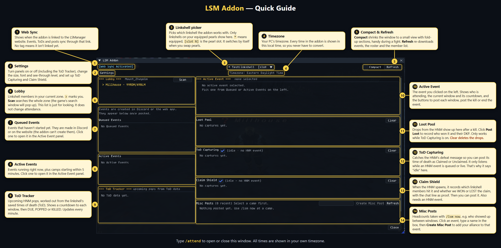

---

## Install and pair — one time

1. Copy the `lsm` folder into `Ashita/addons/lsm/`, then load it in game:
   ```
   /addon load lsm
   ```
2. In the app, open the **Game Addon** tab → **Pair Code** → **+ Get Code**. Codes expire in a few minutes.
3. In game, redeem it:
   ```
   /lsm link <code>
   ```
   **One code pairs every linkshell you belong to.** There is no slot to pick: the addon lists
   whichever paired linkshells are on your two equipped pearls.
4. Check it worked with `/lsm status`. The launcher's header now shows **[Web Sync Activated]**.

> **Self-hosting?** Run `/lsm server https://your-lsmanager-host` before pairing. Everyone else can
> skip this — the addon ships pointed at `https://linkshellmanager.com`.

---

## The launcher — `/attend`

The **left side** picks the camp: who is in the zone, the queued and active events, and posts
waiting to be filed. The **right side** runs the camp you picked.

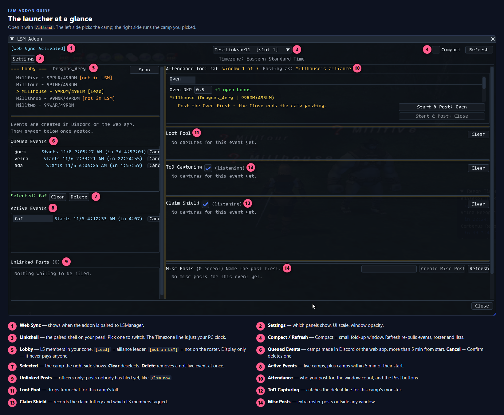

- An event sits in **Queued Events** until 5 minutes before its start, then moves to **Active Events**.
- The **Lobby** is for looking only. It never pays anyone — only a **Post** does.
- **Refresh** re-pulls events, the roster and every list. Use it after someone changes an event in the app.

### Compact mode

Tick **Compact** for a small fold-up window with the same tools — handy mid-fight.

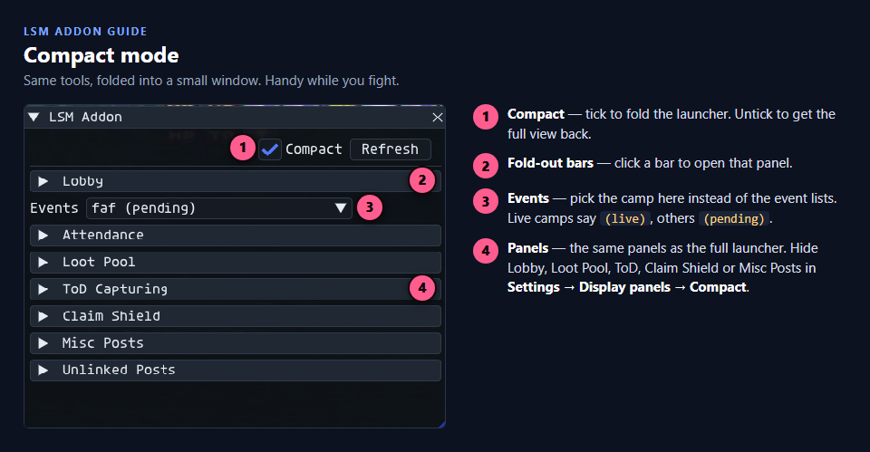

---

## Running an HNM camp

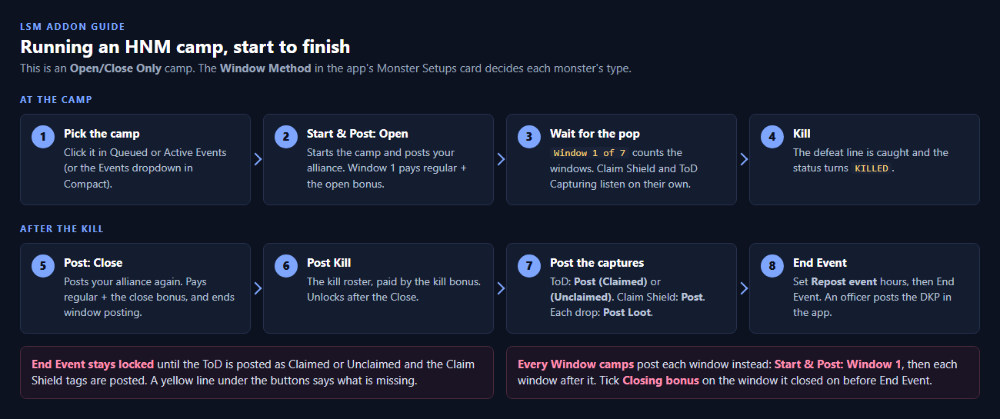

Each monster's **Window Method** (Configurations → Monster Setups in the app) decides how the camp posts:

| Window Method | What you post |
|---|---|
| **Open/Close Only** | **Open** at the start, **Close** at the end, then the **Kill** roster. |
| **Every Window** | One post per window: **Window 1** (pays the open bonus), Window 2, 3… Tick **Closing bonus** on the window it closed on. |

### Posting attendance

Your **alliance is worked out for you** — the addon reads the alliance leader, shown as
**Posting as: <leader>'s alliance**. Each post gets its own tab, and you can still fix a post
after it is made.

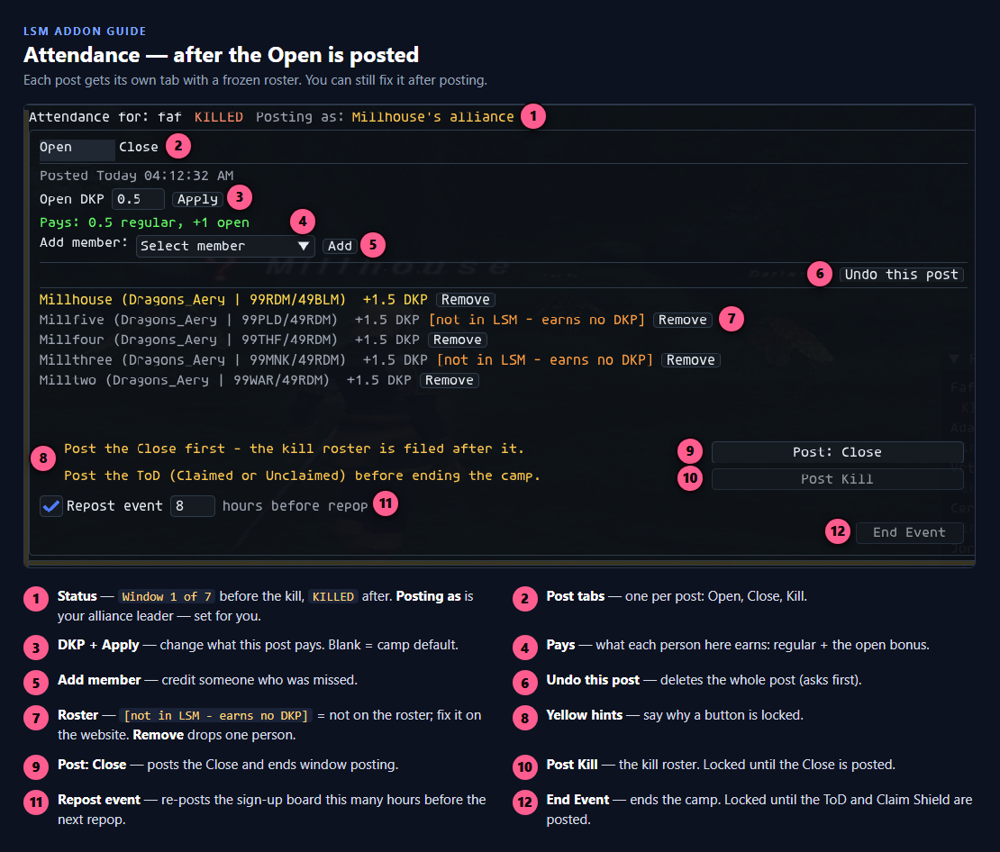

After the kill, post the **Close**, then the **Kill** roster. **End Event** stays greyed out until
the yellow line under the buttons is cleared.

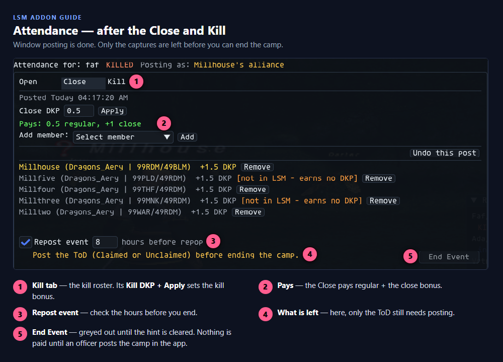

> **End Event does not pay anyone yet.** It hands the camp to the app, where an officer reviews it
> and posts the DKP.

### Your camp in the app

Every post you make shows up on the camp's card in the app (**Event System → Current**) within
seconds. Members can check what they will earn there, and officers can fix a post.

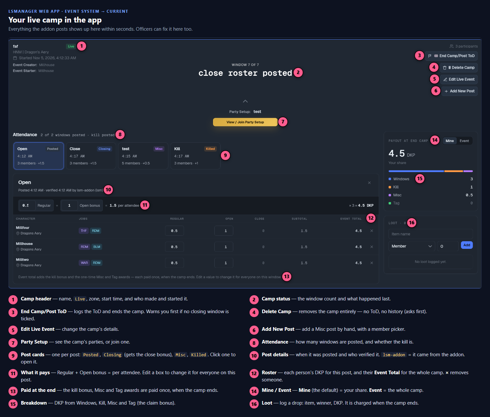

### Loot, ToD and Claim Shield

These three panels **fill in by themselves** from chat while a camp is queued or live. Your job
is to press **Post** on each one. **Clear** only clears your own screen — nothing on the web changes.

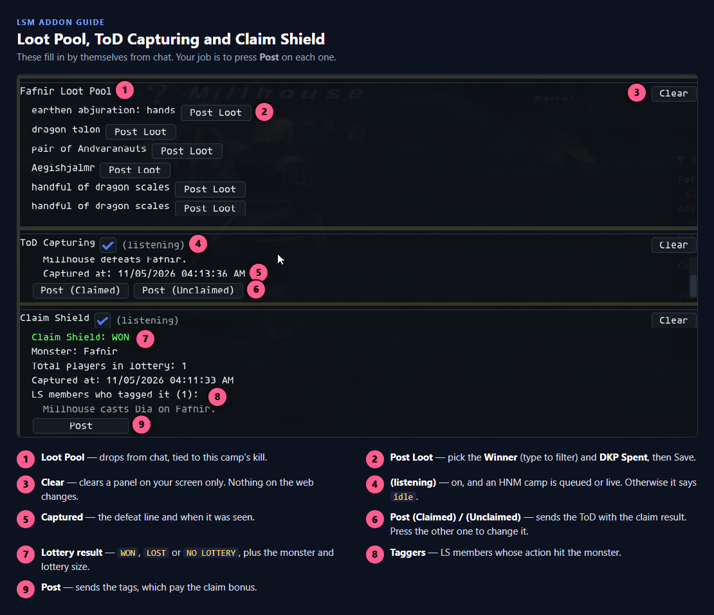

- **ToD** — press **Post (Claimed)** or **Post (Unclaimed)**. Pressed the wrong one? Press the other.
- **Claim Shield** — **Post** sends the tags, which pay the claim bonus.
- **Loot** — **Post Loot** on each drop, pick the winner and the DKP spent, then **Save**.

The monsters the addon listens for are the ones in **Monster Setups**. Add a new NM there with
**+ Add monster**; the addon picks it up on the next **Refresh**.

### Misc Posts

A roster post **outside any window** — for example a mid-camp headcount. Name it, then press
**Create Misc Post**. If the camp is still queued, this starts it first.

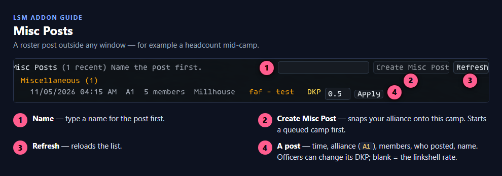

---

## Repop Timer — `/repop`

A small window that counts down to every tracked monster's next repop. It is display only.

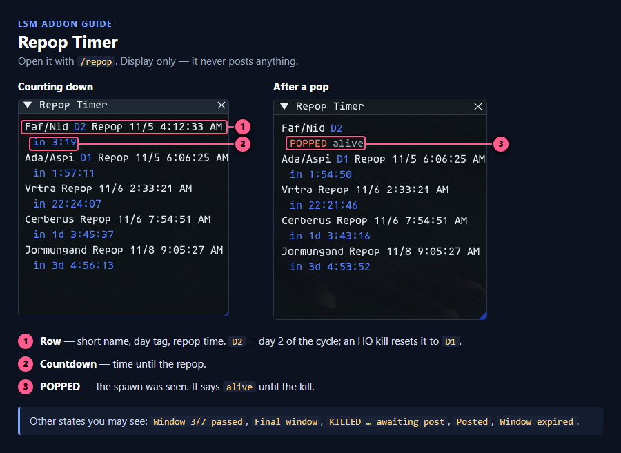

Tick **Settings → Display → Repop Timer** if you also want it to open with `/attend`.

---

## `/lsm now` and Unlinked Posts

`/lsm now [name]` snaps your alliance right now (add `p` for just your party), for example
`/lsm now "Fafnir D2"`. It writes a local CSV and sends the post to LSManager **unfiled**, so an
officer can file it onto an event later.

**Anyone paired can use `/lsm now`.** What happens next depends on the **Manage attendance with the
addon** permission (Configurations → Permissions; on for Leader and Officer by default):

| You have the permission | You don't |
|---|---|
| Your post counts straight away. You can also run camps, post windows and set DKP. | Your post arrives **Pending**. Its people earn nothing until an officer presses **Confirm**. |

Officers file posts from the **Unlinked Posts** panel in the addon…

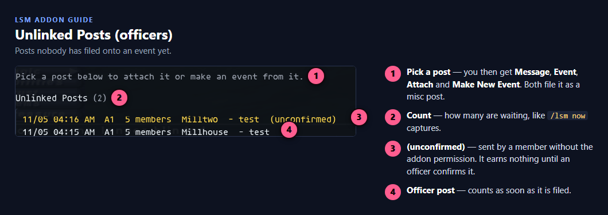

…or from **Event System → Current → Unlinked Snapshots** in the app. A member's post waits under
**Awaiting confirmation**:

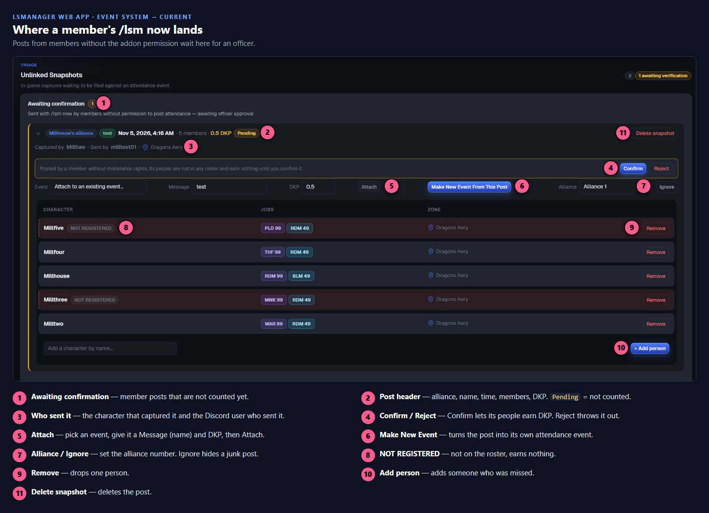

An officer's post (or a confirmed one) skips that step and waits under **Unlinked**:

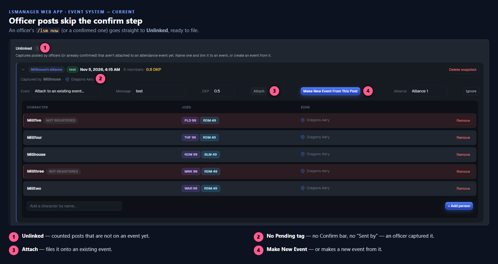

Either way the post is filed as a **Misc** post: **Attach** puts it on an existing event, and
**Make New Event** turns it into its own attendance event.

---

## One poster per alliance

A post is **one alliance** — up to 18 people, read from party memory. The game gives an addon no
way to see players outside your own alliance, so:

> **Every alliance at a camp needs at least one member with the addon paired.**
> An alliance with no poster is not counted.

Nobody has to set an alliance number — the addon reads the alliance leader for you. If the app
gets the number wrong, an officer can change it on the post (the **Alliance** box).

---

## Commands

| Command | What it does |
|---|---|
| `/attend` · `/attend close` | Open or close the launcher. |
| `/repop` · `/repop close` | Open or close the Repop Timer. |
| `/lsm link <code>` | Pair the addon (one code covers every linkshell you're in). |
| `/lsm unlink [name\|all]` | Drop one pairing, or all of them. |
| `/lsm status` | Show the server, your pairings and which pearl slot each shell is in. |
| `/lsm now [name] [p\|a]` | Snap your alliance (`a`, the default) or party (`p`) to a CSV and the web. |
| `/lsm roster` | Check the linkshell roster against your alliance — who your next post will and won't pay. |
| `/lsm jobs` | List the jobs the addon has learned this session. |
| `/lsm slots` · `/lsm slots swap` | Check what each pearl slot reads, or swap them if they're backwards. |
| `/lsm server <url>` | Point at a self-hosted LSManager. |
| `/lsm help` | Print the command list in chat. |

**Troubleshooting toggles:** `/lsm todcapture` (log every defeat line), `/lsm claimshield debug`,
`/lsm repop debug`, `/lsm seaprobe` (Lobby **Scan** problems).

Gone for good: `/lsm alliance` (automatic now), `/lsm checkin` / `/lsm checkout` (Manual Check In
camps use the **Check In** / **Check Out** buttons on the Discord camp board), and creating events
in game.

---

## Settings

Open **Settings** from the launcher's top-left corner.

| Section | What it sets |
|---|---|
| **Display** | Open the Repop Timer with `/attend`; draw the addon cursor. |
| **Display panels** | Which panels show in the Main and Compact views (Lobby, Loot Pool, ToD Capturing, Claim Shield, Misc Posts). |
| **UI Scale** | Scale and font size. |
| **Window Opacity** | Main, Compact, Settings and Repop Timer. These apply live and are not saved. |

Press **Save** to keep your changes. DKP amounts are not set here — they live in the app's
**HNM Settings** and each camp's **Change DKP**.

---

## Quick reference
- **Pair:** `/addon load lsm` → Game Addon → Pair Code → **+ Get Code** → `/lsm link <code>`.
- **Run a camp:** `/attend` → pick the camp → **Start & Post: Open** → **Post: Close** → **Post Kill** → post the ToD, Claim Shield and loot → **End Event**.
- **Quick headcount:** `/lsm now [name]`, then file it from **Unlinked Posts**.
- **Repop countdowns:** `/repop`.
- **Every alliance needs its own poster.**
- **Companion guides:** [Web App](LSManager-WebApp-Guide.md) · [Discord Activity](LSManager-DiscordActivity-Guide.md)
